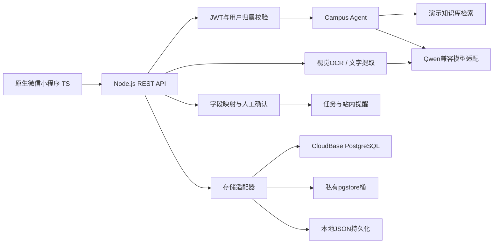

# 技术架构与数据流

模型可调用的只读工具是`identifyService`、`searchCampusKnowledge`和`generateChecklist`；OCR、生成/校验表单、创建提醒和获取状态通过带身份的应用接口执行。模型不能自行完成支付、校方申请提交或审批。

Agent模型返回严格校验的JSON；实际步骤按受支持事项的业务清单规范化，引用必须对应持久化知识库中的真实sourceId。Qwen调用失败时明确返回`mode=fallback`及错误码，使用知识库参考清单；离线模式标记`mode=offline`，不能当实时AI展示。检索目前为关键词排序，有独立Embedding适配器但未配置向量模型，不宣称已实现向量RAG。

识别图片最多8MB，检查MIME和文件签名后发送视觉模型。模型不会因失败生成虚构个人字段。文字提取和虚构样本分别标记`text`/`sample`。字段按服务白名单映射，空值保留，用户修正并通过校验确认后方可创建关联表单任务。

PostgreSQL十表采用固定主键、用户归属列、JSONB业务载荷、时间戳与索引。JSONB允许结构化Agent输出演进，user_id用于归属过滤。服务端仅允许表名白名单；不拼接用户SQL。十表RLS开启，对anon/authenticated关闭直接读写。Node后端API Key属于service_role，因此应用层每次读取、修改关联对象时都校验归属，不能把数据库RLS误称为独立JWT的用户隔离。

小程序可选演示登录、`wx.login`服务端交换、CloudBase原生身份票据三种适配。真实模式须配AppSecret或部署签名身份桥接云函数。

当前提醒为应用内持久化日程。微信订阅通知需要模板、授权和定时触发器，尚未启用。任务完成百分比来自用户勾选的节点，不代表校方处理状态。
